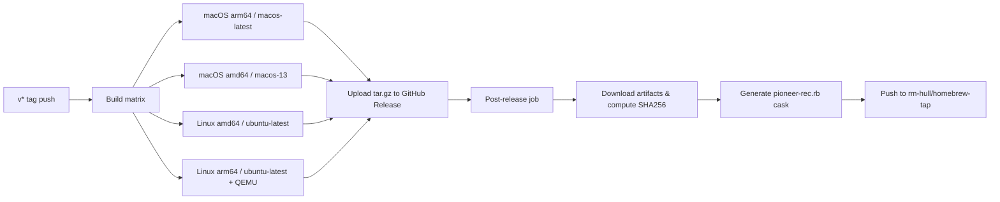

# Requirements

### Overview
Publish `pioneer-rec` to the Homebrew tap `rm-hull/homebrew-tap` so users can install via `brew install rm-hull/tap/pioneer-rec`. The project is a C single-file application built with `make`, producing 4 binaries for different recorder models.

### Scope
**In Scope:**
- GitHub Actions release workflow triggered on `v*` tags
- Multi-platform builds: macOS (arm64, amd64), Linux (amd64, arm64)
- Automatic cask generation and push to `rm-hull/homebrew-tap`
- All 4 binaries packaged in a single `tar.gz` per platform

**Out of Scope:**
- Publishing variant binaries as separate casks
- Code signing and notarization
- goreleaser Pro features

### Key Findings
- `make all` produces 4 binaries: `pioneer_rec` (default DVR-633H), `pioneer_rec_520`, `pioneer_rec_545`, `pioneer_rec_550`
- No tags or releases exist yet (35 commits, no `v*` tags)
- CI already builds on Ubuntu and macOS but doesn't create releases
- goreleaser's `prebuilt` builder is Pro-only; pure GitHub Actions is the free approach
- `HOMEBREW_TAP_GITHUB_TOKEN` secret already exists for `git-commit-summary`

# Technical Design

### Current Implementation
- Single source file `pioneer_rec.c` + 4 header variants (`dvr520h.h`, `dvr545h.h`, `dvr550h.h`, `dvr633h.h`) + `portable.h`
- `Makefile` with targets: `pioneer_rec`, `pioneer_rec_520`, `pioneer_rec_545`, `pioneer_rec_550`, `all`, `check`, `clean`
- Existing CI workflow (`.github/workflows/ci.yml`) builds on Ubuntu and macOS
- No release workflow, no GitHub Releases, no Homebrew cask

### Key Decisions
- **Pure GitHub Actions** (no goreleaser): Free tier, no Pro dependency, full control over cask generation
- **Native compilation on matching runners**: Simpler than cross-compilation, reliable binary output
- **Linux arm64 via QEMU**: Only platform requiring cross-compilation; `qemu-user-static` provides adequate support
- **Single cask for default binary**: `pioneer_rec` (DVR-633H) is the primary binary; variants included in the same archive

### Proposed Changes

#### 1. Release workflow (`.github/workflows/release.yml`)
Triggers on `v*` tag pushes. Build matrix:
- **macOS arm64**: `macos-latest` runner, native `make all`
- **macOS amd64**: `macos-13` runner, native `make all`
- **Linux amd64**: `ubuntu-latest`, native `make all`
- **Linux arm64**: `ubuntu-latest` with `qemu-user-static`, cross-compiled `make all`

Each job packages binaries into `tar.gz` and uploads to GitHub Release.

#### 2. Post-release cask generation
A dependent job:
- Downloads `tar.gz` artifacts
- Computes SHA256 checksums
- Generates `pioneer-rec.rb` cask (same format as existing `git-commit-summary.rb`)
- Commits and pushes to `rm-hull/homebrew-tap` using `HOMEBREW_TAP_GITHUB_TOKEN`

#### Architecture

#### Cask Format
Following `git-commit-summary.rb` structure:
- `version` from the tag
- `on_macos` / `on_linux` with `on_arm` / `on_intel` sub-blocks
- Each block: `sha256` and `url` pointing to GitHub release asset
- `binary "pioneer_rec"` for the default binary
- `postflight` to remove `com.apple.quarantine` on macOS

# Delivery Steps

### ✓ Step 1: Create release workflow with multi-platform build matrix
Create `.github/workflows/release.yml` that triggers on `v*` tag pushes.
- Define a build matrix: macOS arm64 (`macos-latest`), macOS amd64 (`macos-13`), Linux amd64 (`ubuntu-latest`), Linux arm64 (`ubuntu-latest` with QEMU cross-compilation).
- Each job runs `make all` natively (or via QEMU for Linux arm64).
- Package the 4 binaries (`pioneer_rec`, `pioneer_rec_520`, `pioneer_rec_545`, `pioneer_rec_550`) into a `tar.gz` archive.
- Upload the `tar.gz` as a GitHub Release artifact.

### ✓ Step 2: Add post-release cask generation and push
Add a post-release job to the `release.yml` workflow.
- Download the uploaded `tar.gz` artifacts from the GitHub Release.
- Compute SHA256 checksums for each platform's artifact.
- Generate a `pioneer-rec.rb` cask file with `on_macos`/`on_linux` and `on_arm`/`on_intel` blocks, including version, sha256, and URL fields.
- Commit and push the cask to `rm-hull/homebrew-tap` using the `HOMEBREW_TAP_GITHUB_TOKEN` secret.
- Include `postflight` block to remove `com.apple.quarantine` on macOS.

###   Step 3: Create initial release and verify installation
Create the initial release so users can install via Homebrew.
- Cut a `v1.0.0` tag (or appropriate version).
- Push the tag to trigger the release workflow.
- Verify that the GitHub Release is created with all artifacts.
- Verify that `pioneer-rec.rb` is pushed to `rm-hull/homebrew-tap`.
- Test: `brew install rm-hull/tap/pioneer-rec`